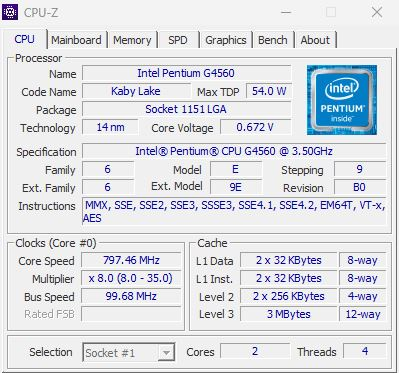
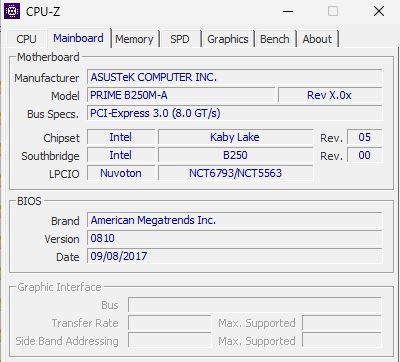
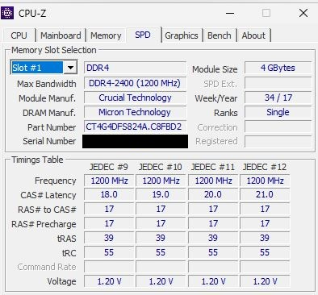
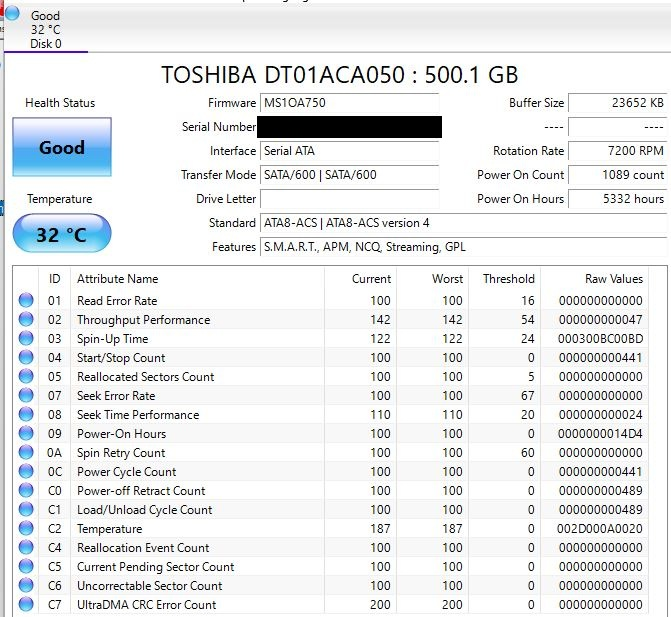
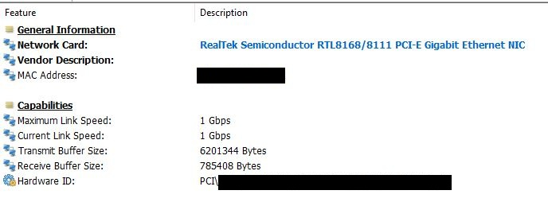

# Inventario investigado y viabilidad

## Contexto de la observacion

- Fecha y sistema utilizado: 13/10/2026. Para ver el hardware arranqué el PC de clase con Hiren's BootCD PE desde un USB, así que no instalé ni toqué nada del disco. La RAM, el disco, el KVM y la versión de VirtualBox los miré desde LliureX, que es el sistema que trae el equipo.
- Modalidad, equipo anfitrion y VM VirtualBox si procede: Voy a hacerlo virtualizado, con Proxmox dentro de una VM de VirtualBox. El anfitrión es un PC del departamento que me han asignado en clase, con LliureX, y lo uso solo para las fases 1 y 2. VirtualBox 7.0.12 ya viene instalado, pero todavía no he creado la VM de Proxmox.
- Version de Proxmox prevista: 9.2 (ISO 9.2-1). Es la última que sale en https://www.proxmox.com/en/downloads, que consulté el 13/10/2026.
- Restricciones de acceso: no tuve ninguna. Entré en la BIOS solo para poner el USB como primer dispositivo de arranque y poder iniciar Hiren's, y no cambié nada más.

## Inventario inicial

| Area | Dato observado y evidencia | Especificacion y fuente | Limite o diferencia | Justificacion |
|---|---|---|---|---|
| CPU | Intel Pentium G4560, 2 núcleos / 4 hilos, VT-x ([captura CPU-Z](../evidencias/capturas-o-salidas/s02-cpu.jpg)) | 64 bits, VT-x y EPT (Intel ARK) | Solo 2 núcleos físicos | Puede virtualizar, pero va justo en carga al tener solo dos núcleos físicos |
| RAM | 2 módulos Crucial CT4G4DFS824A.C8FBD2 de 4 GB (8 GB), DDR4-2400 ([captura SPD](../evidencias/capturas-o-salidas/s02-ram.jpg)). Linux ve 7,6 GiB y 5,9 libres ([salida](../evidencias/capturas-o-salidas/s02-datos-equipo.txt)) | DDR4-2133/2400 (Intel ARK). 2 GB para Proxmox más las VMs (web de Proxmox) | Poca memoria para Proxmox y 2 VMs | Es poca memoria y me limita el reparto, pero creo que me llega si la ajusto bien |
| Almacenamiento | HDD Toshiba DT01ACA050 de 500 GB, estado Good, 5332 horas de uso ([captura](../evidencias/capturas-o-salidas/s02-disco.jpg)). 391 GiB libres ([salida](../evidencias/capturas-o-salidas/s02-datos-equipo.txt)) | 7200 rpm, SATA 6 Gbit/s, 64 MiB de caché (ficha Toshiba) | Es un HDD y Proxmox recomienda SSD | Hay espacio de sobra, pero será lento |
| Red | Realtek RTL8168/8111 Gigabit, enlace actual a 1 Gbps ([captura](../evidencias/capturas-o-salidas/s02-red.jpg)) | Proxmox recomienda Gigabit (web de Proxmox) | Velocidad real de transferencia sin medir | Suficiente para el laboratorio |
| Plataforma | ASUS PRIME B250M-A, BIOS 0810 (09/08/2017) ([captura](../evidencias/capturas-o-salidas/s02-placa.jpg)). Arranque UEFI, con partición /boot/efi en LliureX ([salida](../evidencias/capturas-o-salidas/s02-datos-equipo.txt)) | Proxmox pide CPU y placa con VT (web de Proxmox) | BIOS de 2017 | No debería dar problemas para arrancar |

## 1. Puedo instalar Proxmox en este equipo?

Comparo lo que tiene mi equipo con los requisitos que da Proxmox en su web.

| Componente o requisito | Dato de mi equipo y evidencia | Requisito consultado y fuente | Cumple, no cumple o pendiente |
|---|---|---|---|
| CPU, arquitectura y nucleos/hilos | G4560, 64 bits, 2 núcleos / 4 hilos | 64 bits (Proxmox) | Cumple |
| Soporte de virtualizacion y configuracion | VT-x y /dev/kvm | Intel VT o AMD-V (Proxmox) | Cumple en el equipo; en VirtualBox pendiente |
| RAM | 8 GB instalados, 7,6 GiB visibles | Mínimo 1 GB (Proxmox) | Cumple el mínimo |
| Almacenamiento | HDD de 500 GB | Un disco; recomendado SSD (Proxmox) | Cumple el mínimo; no el recomendado |
| Red | Gigabit | Una tarjeta de red (Proxmox) | Cumple |
| Plataforma, firmware y arranque | UEFI (/boot/efi) | CPU y placa con VT (Proxmox) | Cumple |

- Puedo instalar y arrancar Proxmox: Sí. Cumplo los mínimos de evaluación: CPU de 64 bits con VT-x, más de 1 GB de RAM, un disco y una tarjeta de red. Además /dev/kvm existe, así que la virtualización está activada en la BIOS. No lo voy a instalar directamente en este PC, sino dentro de una VM de VirtualBox.
- Puedo ejecutar el servidor ASO y el cliente del proyecto: Con condiciones. Tengo 7,6 GiB de RAM y LliureX ya gasta 1,2 en reposo, solo 2 núcleos físicos y un HDD que no es el SSD que recomienda Proxmox. Creo que entran Proxmox, srv-aso y cli-linux, pero justo, y puede que tenga que usar LXC en vez de VMs.
- Condiciones o comprobaciones pendientes: leer en el manual de VirtualBox 7.0 el apartado Processor Tab (la casilla de virtualización anidada) y probarla de verdad cuando cree la VM de Proxmox, y medir más adelante lo lento que va el HDD.

## 2. Que limitaciones tendre con este hardware?

### Reparto de recursos

| Elemento | CPU/vCPU | RAM | Disco | Justificacion |
|---|---|---|---|---|
| Proxmox | 2 vCPU | 2 GiB | 20 GiB | Proxmox recomienda 2 GB para el sistema (web de Proxmox) |
| srv-aso | 1 vCPU | 1 GiB | 10 GiB | Es un servidor de ficheros sencillo, así que prefiero ir con lo mínimo y subirlo si veo que se queda corto |
| cli-linux | 1 vCPU | 0,5 GiB | 8 GiB | Solo se va a usar para pruebas |
| Plantilla, ISOs y copias | No aplica | No aplica | 28 GiB | 8 GiB para plantillas y 20 GiB de ISOs y copias |
| Margen de operacion | No aplica | 1,5 GiB | 14 GiB | Para otros usos y para que Proxmox no se quede sin memoria |

**Calculos y supuestos**

- RAM del anfitrión: 7,6 GiB totales - 5 GiB para la VM de Proxmox = 2,6 GiB para LliureX y VirtualBox. LliureX gasta 1,2 GiB en reposo, así que me quedan unos 1,4 GiB de margen en el anfitrión. El manual de VirtualBox 7.0 avisa de que si al anfitrión le queda poca RAM empieza a tirar de swap y se queda casi parado, por eso no le doy más a la VM.
- RAM dentro de la VM: 2 + 1 + 0,5 + 1,5 de margen = 5 GiB. La práctica recomienda 6-8 GB para la VM de Proxmox, pero con 7,6 GiB en total y LliureX encendido no puedo darle tanto.
- Disco: 391 GiB libres - 80 GiB del VDI = 311 GiB libres en el anfitrión. Dentro de la VM: 20 + 10 + 8 + 28 + 14 = 80 GiB. Cuento los 80 GiB como si el VDI estuviera lleno del todo, para quedarme en el peor caso (según el manual, un disco dinámico solo crece según se usa).
- CPU: el PC tiene 4 hilos y le doy 2 vCPU a la VM de Proxmox. El manual de VirtualBox 7.0 aconseja no asignar a una VM más de la mitad de los hilos del anfitrión, y con 2 de 4 cumplo justo eso. Los vCPU de srv-aso y cli-linux (1 cada uno) no se suman a esos 2, salen de ellos, así que dentro de Proxmox hay 2 vCPU repartidos entre las tres cosas. Las vCPU no son núcleos exclusivos.
- No cuento la swap (511 MiB) como RAM, y supongo LliureX en reposo (1,2 GiB usados según free -h).
- Cargas a la vez: creo que Proxmox, srv-aso y cli-linux pueden estar encendidos a la vez. Clonar o hacer copias mientras uso el servicio será lento por culpa del HDD.

### Limitaciones

| Limitacion o dato pendiente | Evidencia o estimacion | Consecuencia para el proyecto | Medida y limite que permanece |
|---|---|---|---|
| RAM justa (medido) | free -h: 7,6 GiB totales y 1,2 GiB que gasta LliureX en reposo | Solo puedo dar 5 GiB a la VM de Proxmox, menos de los 6-8 GB orientativos | Uso LXC si hace falta y no enciendo nada más. No arregla que la RAM total sea poca |
| CPU con pocos nucleos (medido) | 2 núcleos y 4 hilos, sin Turbo Boost (Intel ARK) | Proxmox y los dos invitados se reparten solo 2 vCPU | Evito tener dos cosas pesadas a la vez. Solo se resuelve cambiando de procesador |
| Disco mecanico (tipo medido, lentitud estimada) | HDD de 7200 rpm (CrystalDiskInfo y ficha Toshiba). No he medido su velocidad | Clonar, hacer copias y arrancar varias máquinas a la vez irá lento | Hago clones y copias de uno en uno. Lo mido en la Fase 10 y seguirá siendo un HDD |
| Virtualizacion anidada (pendiente) | /dev/kvm existe y el G4560 tiene EPT (Intel ARK). Falta leer el apartado Processor Tab del manual de VirtualBox 7.0 y probarla en la VM | Si no funciona, no podré usar VMs dentro de Proxmox | Uso LXC para srv-aso y cli-linux. No sirve si VirtualBox ni siquiera arranca Proxmox |
| Copias en el mismo disco (prevision) | Solo hay un disco físico, el Toshiba de 500 GB | Si el disco falla, pierdo las VMs y las copias a la vez | Guardo las copias en el almacenamiento autorizado por el profesor. Si no hay otro, el riesgo se queda |

### Medidas que voy a aplicar

- **Ajustar el reparto de recursos:** le doy 5 GiB de RAM a la VM de Proxmox y no los 6-8 GB orientativos, para que a LliureX y VirtualBox les queden 2,6 GiB. Con esto el anfitrión no se queda sin memoria, pero no arregla que la RAM total sea poca.
- **Usar LXC cuando proceda:** los contenedores gastan menos RAM que las VMs completas, así que son mi plan B para srv-aso y cli-linux. Ayudan con la memoria, pero no con la lentitud del HDD.
- **Reducir cargas simultaneas:** no voy a clonar, hacer copias y usar el servicio a la vez. Evita que el disco y los 2 vCPU se saturen, pero a cambio tardaré más en hacer las cosas.
- **Ampliar un componente:** lo que más ayudaría sería un SSD, porque el problema que más creo que se va a notar es el HDD. De momento no lo voy a comprar, así que ese límite se queda.

Lo que he **observado** es la RAM, los núcleos y el tipo de disco. Lo que **comprobaré más adelante** es la virtualización anidada en VirtualBox, lo lento que va realmente el HDD y si aguanto las tres máquinas encendidas a la vez.

Con este equipo sí puedo hacer el proyecto, aunque justo, así que no me hace falta cambiar a otro Proxmox.

## 3. Que componentes son mas criticos en mi servidor y por que?

| Prioridad y componente | Funcion en mi servidor | Efecto si es insuficiente | Efecto si falla | Evidencia y justificacion de la prioridad |
|---|---|---|---|---|
| 1. Almacenamiento (HDD Toshiba de 500 GB) | Guarda Proxmox, las VMs/LXC, la plantilla y las copias | Todo va lento al clonar, copiar y arrancar varias máquinas | Pierdo las máquinas y las copias a la vez, porque solo hay un disco | HDD de 7200 rpm con 5332 horas de uso, estado Good y 0 sectores dañados (CrystalDiskInfo). Hoy está sano, pero Proxmox recomienda SSD (ficha de Toshiba y web de Proxmox) |
| 2. RAM (7,6 GiB) | Memoria para Proxmox, srv-aso y cli-linux | No caben todas encendidas y el sistema tira de swap, que es lenta | El nodo se cae, pero los datos del disco siguen ahí | free -h: solo puedo dar 5 GiB a la VM de Proxmox |
| 3. CPU (Pentium G4560) | Ejecuta Proxmox y las dos máquinas | Todo se ralentiza si hay dos cosas pesadas a la vez | Nada funciona hasta cambiarla, pero no se pierden datos | 2 núcleos físicos y sin Turbo Boost (Intel ARK); para un Samba con pocos usuarios llega |

**Lo que limita el rendimiento y lo que mas daño haria si falla**

- Limita el rendimiento: el disco duro, que es lo más lento del equipo, y la RAM, que decide cuántas máquinas puedo tener encendidas a la vez.
- Mayor impacto si falla: el disco, porque es el único y ahí están las máquinas, la plantilla y las copias, así que afecta a la integridad de los datos. Si fallan la RAM o la CPU el servicio se para (disponibilidad), pero los datos no se pierden.

**Componente que mejoraria primero:** el almacenamiento, con un SSD. Lo priorizo frente a ampliar la RAM porque la RAM la puedo apañar con LXC y repartiéndola mejor, pero la lentitud de un HDD no la puedo arreglar de ninguna forma. Además, el disco es lo que más daño haría si falla.

## Fuentes tecnicas

| Fuente y URL | Version/modelo y fecha de consulta | Afirmacion respaldada | Aplicacion al nodo |
|---|---|---|---|
| Proxmox VE, requisitos de sistema. https://www.proxmox.com/en/products/proxmox-virtual-environment/requirements | La página no indica versión. Consultada el 13/10/2026 | Mínimos: 64 bits con VT, 1 GB de RAM, un disco y una tarjeta de red. Recomendado: 2 GB para Proxmox más las VMs, SSD y red Gigabit | Pregunta 1 (tabla de requisitos), Pregunta 2 (RAM) y Pregunta 3 (almacenamiento) |
| Proxmox, página de descargas. https://www.proxmox.com/en/downloads | Proxmox VE 9.2 (ISO 9.2-1). Consultada el 13/10/2026 | La 9.2 es la última versión disponible | Versión prevista para el nodo |
| Intel ARK, Pentium G4560. https://www.intel.com/content/www/us/en/products/sku/97143/intel-pentium-processor-g4560-3m-cache-3-50-ghz/specifications.html | Pentium G4560. Consultada el 13/10/2026 | 64 bits, 2 núcleos y 4 hilos, VT-x, EPT, VT-d, DDR4-2133/2400 y sin Turbo Boost | Pregunta 1 (CPU y virtualización) y Pregunta 3 (CPU) |
| Toshiba, DT Series Desktop HDD. https://toshiba.semicon-storage.com/content/dam/toshiba-ss-v3/master/en/storage/product/internal-specialty/HDD-DTENB.pdf | DT01ACA050 (documento HDD-DTENB). Consultada el 13/10/2026 | 7200 rpm, SATA 6 Gbit/s, 64 MiB de caché y CMR | Preguntas 2 y 3 (disco) |
| Oracle, VirtualBox User Guide for Release 7.0. https://docs.oracle.com/en/virtualization/virtualbox/7.0/user/EN-VBOX-7-0-USER.pdf | Release 7.0 (F43655-13, junio 2024); mi versión es la 7.0.12. Consultada el 13/10/2026 | Al crear una VM no conviene asignar más de la mitad de los hilos del anfitrión, hay que dejarle RAM suficiente para que no tire de swap, y un disco dinámico crece según se usa mientras que uno de tamaño fijo ocupa todo el espacio al crearse | Pregunta 2 (reparto de CPU, RAM y disco) |

## Dictamen de viabilidad

Apto con condiciones para la propuesta actual.

Puedo instalar y arrancar Proxmox sin problema, porque cumplo todos los mínimos y la virtualización está activada. Lo que va justo es ejecutar el proyecto completo: la RAM es poca (le puedo dar 5 GiB a la VM de Proxmox), el procesador solo tiene 2 núcleos y el disco es un HDD, que es lo que más creo que se va a notar. Aun así, para un servidor Samba con pocos usuarios y un cliente de pruebas me parece que llega si reparto bien los recursos y uso LXC cuando haga falta.

Las condiciones que me quedan por comprobar son:

- Leer en el manual de VirtualBox 7.0 el apartado de la virtualización anidada y probarla de verdad cuando cree la VM de Proxmox. Si no funciona, usaré LXC.
- Lo lento que va el HDD, que lo mediré en la fase de rendimiento.

## Evidencias y revision docente

Los datos de hardware los saqué con CPU-Z, HWiNFO y CrystalDiskInfo desde Hiren's BootCD PE. En las capturas he tapado los números de serie y la MAC.

**CPU (CPU-Z, pestaña CPU).** Muestra un Pentium G4560 (Kaby Lake) con 2 núcleos, 4 hilos y VT-x en la lista de instrucciones. Resultado: puede virtualizar por hardware. La frecuencia que sale (unos 800 MHz) es porque estaba en reposo, no es su velocidad máxima (3,50 GHz según Intel).

**Placa base (CPU-Z, pestaña Mainboard).** Muestra una ASUS PRIME B250M-A con chipset Intel B250 y BIOS de American Megatrends versión 0810 del 09/08/2017. Resultado: placa de la misma generación que el procesador y con la BIOS antigua, lo que apunto como limitación menor.

**RAM (CPU-Z, pestaña SPD).** Muestra el slot 1: un módulo Crucial de 4 GB, DDR4-2400, referencia CT4G4DFS824A.C8FBD2. Resultado: tengo dos módulos iguales, así que son 8 GB en total, aunque la captura solo enseña el slot 1.

**Disco (CrystalDiskInfo).** Muestra un Toshiba DT01ACA050 de 500 GB, estado Good, 32 °C, 7200 rpm, interfaz SATA/600 y 5332 horas encendido, con 0 sectores reasignados, pendientes o incorregibles. Resultado: el disco está sano, pero es mecánico.

**Red (HWiNFO).** Muestra una Realtek RTL8168/8111 Gigabit con velocidad máxima y velocidad actual del enlace de 1 Gbps. Resultado: cumple el requisito de red y el enlace del aula está a 1 Gbps.

**Salida de comandos en LliureX** ([s02-datos-equipo.txt](../evidencias/capturas-o-salidas/s02-datos-equipo.txt)). Son free -h, df -h, ls -l /dev/kvm y VBoxManage --version, ejecutados el 13/10/2026 a las 09:51. Resultado: 7,6 GiB de RAM (5,9 disponibles), 391 GiB libres en /dev/sda2, /dev/kvm existe y VirtualBox es la 7.0.12. El pendrive de Hiren's (/dev/sdb1) también sale en df, pero no cuenta como disco del equipo.

- Pregunta de defensa y respuesta: pendiente, de momento no me han hecho ninguna.
- Revisión docente: pendiente.

[Volver al indice](../README.md)
