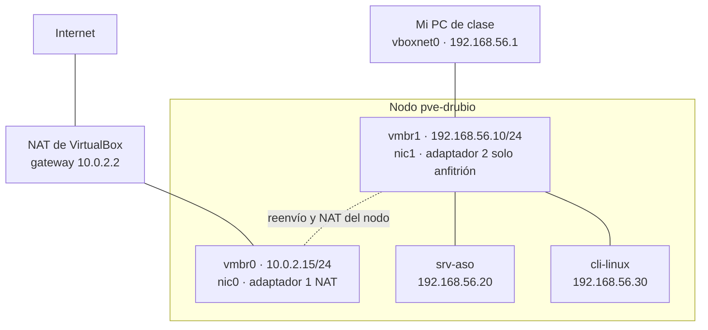
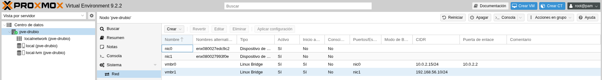
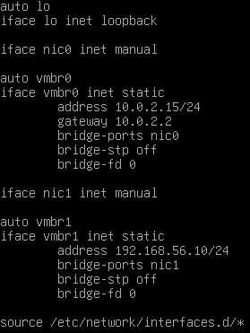
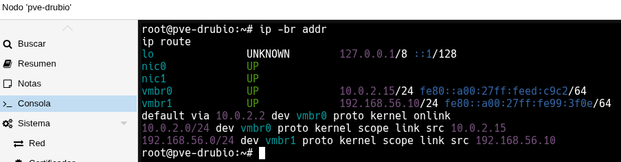

# Diseno de red

## Objetivo

Diseñar la red del laboratorio: cómo se conectan el nodo Proxmox, srv-aso y cli-linux, qué IP lleva cada uno y por dónde sale el tráfico a Internet. Uso la red 192.168.56.0/24 y el DNS de Google, como indicó el profesor.

## Diagrama

- **Entrar al panel:** navegador de mi PC → `vboxnet0` → `vmbr1` → nodo, puerto 8006.
- **Probar el servicio:** `cli-linux` → `vmbr1` → `srv-aso`, sin pasar por el gateway porque están en la misma red.
- **Salir a Internet desde una máquina:** máquina → gateway 192.168.56.10 → NAT del nodo → `vmbr0` → NAT de VirtualBox → Internet.

## Diseno

- Nombre del nodo Proxmox: `pve-drubio`.
- Interfaz de gestion: `nic1`, que es el adaptador 2 de VirtualBox en solo anfitrión. Por ahí entro al panel en https://192.168.56.10:8006.
- Bridge de Proxmox: `vmbr0`, con `nic0` (NAT), es la salida a Internet con la IP 10.0.2.15/24. `vmbr1`, con `nic1` (solo anfitrión), es la red del laboratorio con la IP 192.168.56.10/24.
- Red o VLAN de laboratorio: 192.168.56.0/24 (máscara 255.255.255.0), sin VLAN.
- IPs de las VMs/LXC: mi PC 192.168.56.1, el nodo 192.168.56.10, srv-aso 192.168.56.20 y cli-linux 192.168.56.30.
- Gateway y DNS: srv-aso y cli-linux usan el nodo (192.168.56.10) como gateway. El nodo usa el de VirtualBox (10.0.2.2) y es el único con ruta por defecto. El DNS de todos es 8.8.8.8.
- Puertos necesarios: en la tabla de puertos.
- Medidas de aislamiento: en su apartado.

## Tabla de direccionamiento

| Elemento | Nombre | IP | Funcion | Recursos |
|---|---|---|---|---|
| Nodo Proxmox | pve-drubio | 192.168.56.10 (vmbr1) y 10.0.2.15 (vmbr0) | Hipervisor | VM con 4 vCPU, 8 GB de RAM y 80 GB de disco, de los que unos 2 GB de RAM son para Proxmox |
| Servidor ASO | srv-aso | 192.168.56.20 | Servicio principal | 2 vCPU, 2 GB de RAM y 10 GB de disco |
| Cliente | cli-linux | 192.168.56.30 | Pruebas | 1 vCPU, 1 GB de RAM y 8 GB de disco |

Los recursos de srv-aso y cli-linux salen de los de la VM del nodo. El reparto completo está en [el inventario](01-inventario-hardware.md).

## Puertos necesarios

| Puerto | Servicio | Desde y hacia | Para que lo uso |
|---|---|---|---|
| 8006/TCP | Panel de Proxmox | De mi PC al nodo | Administrar Proxmox |
| 22/TCP | SSH | De mi PC y de cli-linux a srv-aso y al nodo | Administración remota y pruebas |
| 445/TCP | Samba | De cli-linux a srv-aso | Acceder a la carpeta compartida |
| 53/UDP y TCP | DNS | Del nodo y las máquinas a 8.8.8.8 | Resolver nombres |

## Aislamiento

- La red del laboratorio es solo anfitrión: solo la ven mi PC, el nodo y las máquinas, y no llega a la red del instituto.
- La salida a Internet va por el NAT de VirtualBox, que deja salir pero no entrar, y no hay ningún reenvío de puertos.
- srv-aso y cli-linux van solo en `vmbr1`, así que desde el aula no se puede llegar a ellas.

## Evidencias

La red del nodo coincide con el diseño: `vmbr0` con 10.0.2.15/24 y gateway 10.0.2.2, `vmbr1` con 192.168.56.10/24 sin gateway, y una sola ruta por defecto, por `vmbr0`.

## Incidencias

Ninguna.

## Conclusion

La salida a Internet (vmbr0, NAT) va separada de la red del laboratorio (vmbr1, solo anfitrión), y el nodo y las dos máquinas están en la misma red. La red real del nodo coincide con este diseño.

[Volver al indice](../README.md)
