# 03-instalacion-proxmox

## Objetivo

Instalar Proxmox dentro de una máquina virtual de VirtualBox en el equipo de clase y dejarlo con la red que diseñé en la fase 2, para poder entrar al panel web desde el navegador.

## Procedimiento

Lo hice en clase el 27/10/2026.

1. Abrí VirtualBox y apunté la versión: 7.2.4.
2. Usé la ISO de Proxmox VE 9.2.
3. Creé la máquina `pve-rubio`: Debian de 64 bits, 8192 MB de RAM, 4 procesadores y un disco VDI de 80 GB. El PC tiene 8 hilos y 16 GB de RAM, así que me sobran recursos para LliureX y VirtualBox.
4. Le puse dos adaptadores de red: el 1 en NAT, para salir a Internet, y el 2 en solo anfitrión (`vboxnet0`), para entrar al panel desde mi PC.
5. Con la máquina apagada hice los ajustes que pidió el profesor. En Procesador marqué PAE/NX y Nested VT-x/AMD-V, en Aceleración dejé KVM y marqué Nested Paging, y en Almacenamiento puse el controlador SATA de tipo virtio-scsi.
6. Monté la ISO y seguí el instalador: disco `/dev/sda` de 80 GB con ext4, país Spain, zona horaria Europe/Madrid y teclado `es`. En la red usé `nic0`, con el hostname `pve-drubio.local`, la IP `10.0.2.15/24`, el gateway `10.0.2.2` y el DNS `8.8.8.8`.
7. Al terminar quité la ISO y reinicié. La contraseña de root la guardé fuera del repositorio.
8. El instalador solo configura una tarjeta, así que `vmbr1` la añadí a mano en `/etc/network/interfaces`, con `nic1` y la IP `192.168.56.10/24`.
9. Entré desde mi PC a `https://192.168.56.10:8006` con el usuario `root`.
10. Comprobé que KVM está disponible dentro de Proxmox.

## Comandos usados

    # Añadir vmbr1 al final de /etc/network/interfaces
    nano /etc/network/interfaces

    # Lo que escribí
    iface nic1 inet manual

    auto vmbr1
    iface vmbr1 inet static
            address 192.168.56.10/24
            bridge-ports nic1
            bridge-stp off
            bridge-fd 0

    # Aplicar el cambio de red
    systemctl restart networking

    # Comprobaciones de la fase
    hostnamectl
    ip -br addr
    pveversion
    df -h

    # Comprobar KVM
    grep -c vmx /proc/cpuinfo
    ls -l /dev/kvm

## Evidencias

### VirtualBox

Resumen de la máquina `pve-rubio` con sus recursos y los dos adaptadores de red.

Procesador: 4 CPUs con PAE/NX y Nested VT-x/AMD-V marcados.

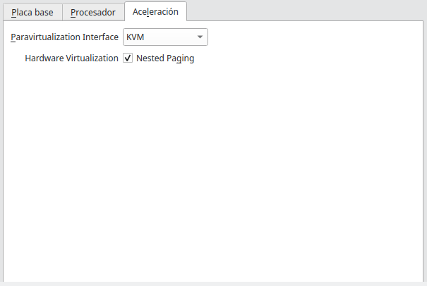

Aceleración: interfaz KVM y Nested Paging marcado.

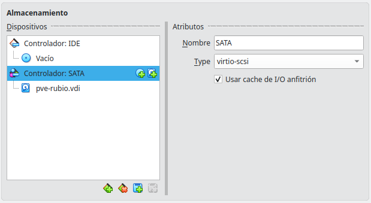

El disco `pve-rubio.vdi` en el controlador SATA de tipo virtio-scsi. La unidad IDE está vacía porque ya quité la ISO.

### Instalador

Pantalla de red del instalador con la interfaz, el hostname, la IP, el gateway y el DNS.

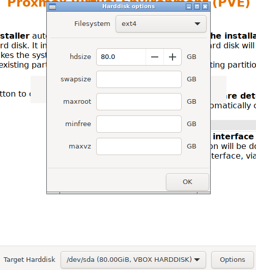

Opciones del disco: ext4 y 80 GB.

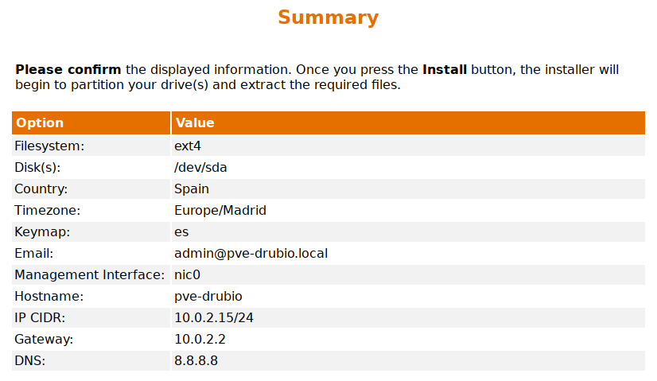

Resumen antes de instalar.

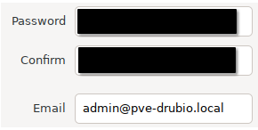

Contraseña de root (tapada) y un correo inventado.

### Red del nodo

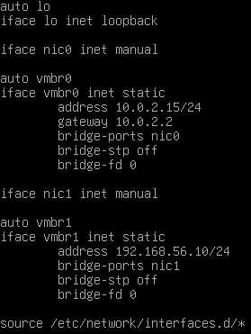

`/etc/network/interfaces` con `vmbr0` (`10.0.2.15/24`, gateway `10.0.2.2`) y `vmbr1` (`192.168.56.10/24`).

Nodo → Sistema → Red: `nic0`, `nic1`, `vmbr0` y `vmbr1`, igual que en mi diseño de la fase 2.

### Panel y almacenamiento

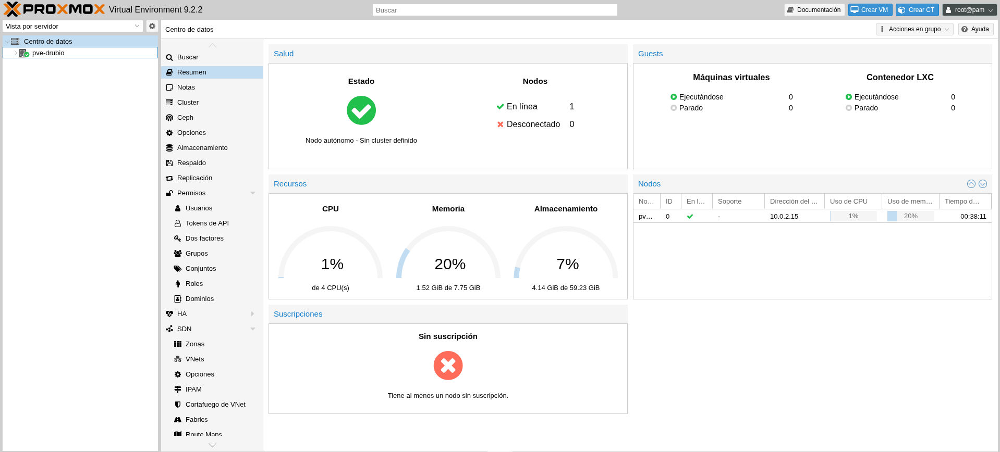

Panel de Proxmox VE 9.2.2 abierto desde mi PC, con el nodo `pve-drubio` en línea.

Almacenamientos: `local` (directorio, para ISO, copias y plantillas) y `local-lvm` (LVM-Thin, para discos de máquinas).

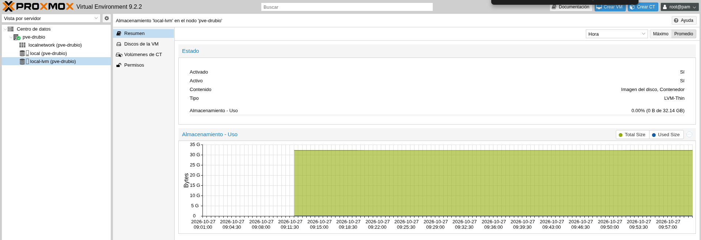

Detalle de `local-lvm`: activo, LVM-Thin y 32,14 GB libres.

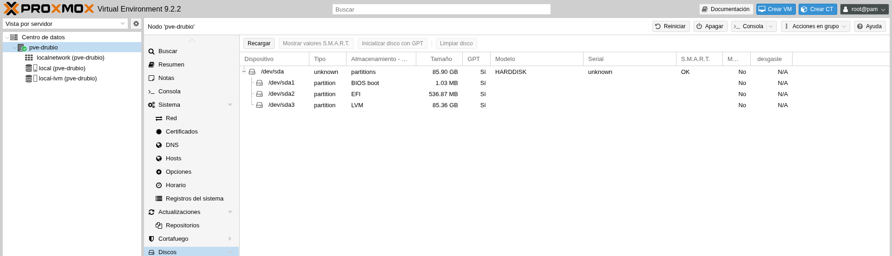

Nodo → Discos: un solo disco, `/dev/sda`, con las particiones BIOS boot, EFI y LVM.

### Comprobaciones

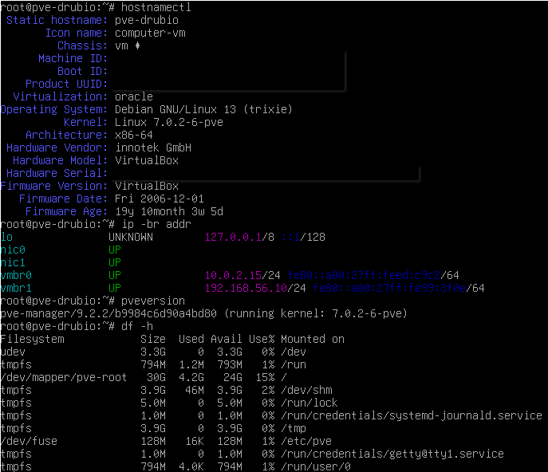

Salida de `hostnamectl`, `ip -br addr`, `pveversion` y `df -h`. He tapado Machine ID, Boot ID, Product UUID y Hardware Serial. El nodo es `pve-drubio`, con Debian 13 y Proxmox VE 9.2.2, y los dos bridges están UP con sus IPs.

`grep -c vmx` da 8 (4 vCPU con 2 líneas cada una) y existe `/dev/kvm`, así que la virtualización anidada funciona.

## Incidencias

- **vmbr1 mal escrita.** Puse la IP como `192.168.65.10` sin el `/24` y escribí `bride` en vez de `bridge`, y `vmbr1` no cogía IP. Lo corregí y reinicié la red con `systemctl restart networking`.
- **Nombre del nodo.** La máquina de VirtualBox se llama `pve-rubio`, pero el nodo se quedó como `pve-drubio`. Tengo que igualarlo en el diseño de red de la fase 2.
- **Pendiente.** Arrancar una máquina KVM de verdad dentro de Proxmox. Si no fuera posible, usaría LXC, validándolo antes con el profesor.

## Conclusion

Proxmox VE 9.2.2 está instalado en VirtualBox y entro al panel desde mi PC en `https://192.168.56.10:8006`. La red es la del diseño, con `vmbr0` para salir a Internet y `vmbr1` para el laboratorio, y la virtualización anidada llega a la máquina.

## Fase 4: Configuración base del nodo

De esta fase hago los puntos 1 y 2: revisar dónde se guarda cada cosa y comprobar que la red coincide con mi diseño.

### 1. Dónde se guardará cada cosa

#### Discos del nodo

Desde la consola del nodo miré el disco y cómo está repartido:

    lsblk -o NAME,SIZE,TYPE,FSTYPE,MOUNTPOINTS
    findmnt /
    pvesm status
    df -h

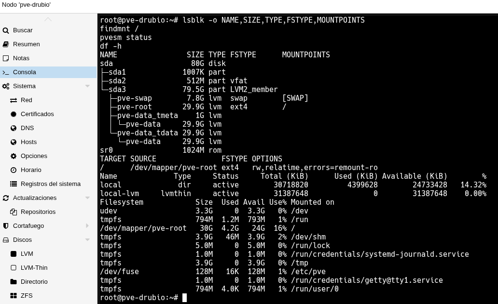

Proxmox ve un solo disco, `sda`, de 80 GB, que es el VDI `pve-rubio.vdi` de VirtualBox. El sistema está en `/dev/mapper/pve-root`. `local-lvm` no sale en `df -h` porque no se monta como una carpeta.

Como instalé con LVM, también saqué los volúmenes:

    pvs
    vgs
    lvs -o lv_name,vg_name,lv_size,segtype,data_percent,metadata_percent

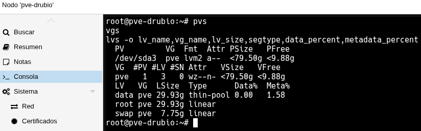

| Dispositivo | Tamaño | Particiones o volúmenes | Uso | VDI |
|---|---|---|---|---|
| `sda` | 80 GB | `sda1` BIOS boot, `sda2` EFI, `sda3` LVM (79,5 GB) | Disco donde está Proxmox | `pve-rubio.vdi` |
| `pve-root` | 29,9 GB | Volumen ext4 montado en `/` | Sistema, `local` y `copias-pi` | `pve-rubio.vdi` |
| `pve-swap` | 7,8 GB | Volumen de swap | Swap | `pve-rubio.vdi` |
| `pve-data` | 29,9 GB | Thin pool (Data 0 %, Meta 1,58 %) | `local-lvm`, discos de las máquinas | `pve-rubio.vdi` |
| Sin asignar | 9,88 GB | Libre en el grupo `pve` | Nada por ahora | `pve-rubio.vdi` |

#### Almacenamientos

Los revisé en Centro de datos → Almacenamiento y en el resumen de cada uno.

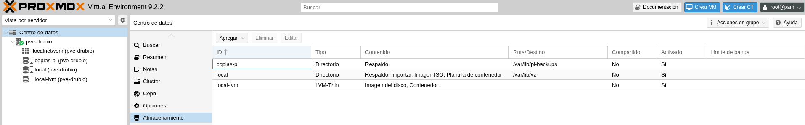

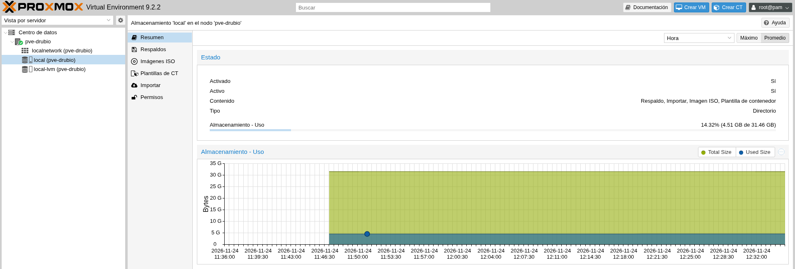

| Almacenamiento | Backend | Ruta o pool | Disco que lo sostiene | Contenido | Espacio disponible |
|---|---|---|---|---|---|
| `local` | Directorio | `/var/lib/vz` | `pve-root` | Respaldo, Importar, Imagen ISO, Plantilla de contenedor | Unos 24 GB |
| `local-lvm` | LVM-Thin | Pool `data` del grupo `pve` | `pve-data` | Imagen de disco, Contenedor | 29,9 GB |
| `copias-pi` | Directorio | `/var/lib/pi-backups` | `pve-root` | Respaldo | Unos 24 GB |

Aunque haya tres almacenamientos, están todos en el mismo disco.

Abrí la opción de subir una ISO en `local` (sin subir nada):

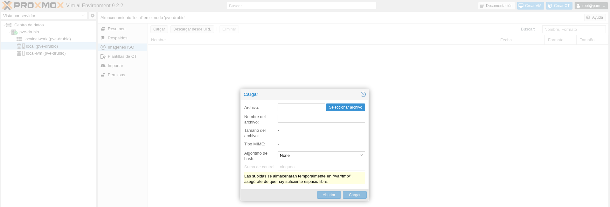

En `local-lvm` esa opción no aparece. Un pool LVM-thin no es una carpeta con archivos, es donde se crean los discos de las máquinas, así que una ISO, que es un archivo, tiene que ir en un almacenamiento de tipo directorio como `local`.

#### Destino de las copias

Creé una carpeta para las copias y la añadí como almacenamiento `copias-pi`, solo para respaldos, en mi nodo y sin compartir:

    mkdir -p /var/lib/pi-backups
    findmnt -T /var/lib/pi-backups
    df -h /var/lib/pi-backups
    pvesm add dir copias-pi --path /var/lib/pi-backups --content backup --nodes pve-drubio --shared 0
    pvesm status

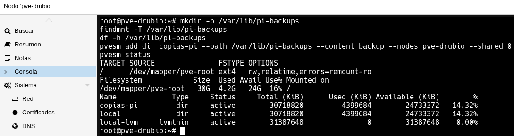

`pvesm status` lo da como `active`. Las copias de verdad se harán en la fase 9.

#### Espacio del anfitrión

También miré el espacio real en el PC de clase:

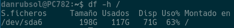

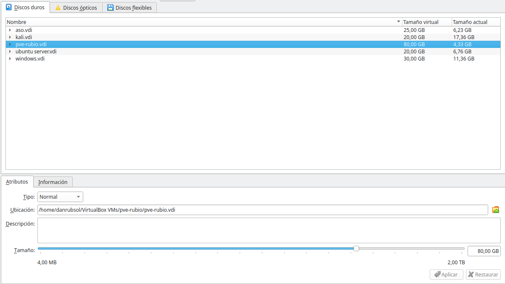

El disco del PC tiene 198 GB y le quedan 71 GB libres. El VDI `pve-rubio.vdi` puede llegar a 80 GB pero ahora ocupa 4,33 GB. Si llegara a llenarse necesitaría unos 76 GB más, y el PC solo tiene 71 libres (además comparte el disco con las máquinas de otras asignaturas), así que tengo que vigilarlo.

Las copias van al mismo disco que todo lo demás: si el disco del PC falla, pierdo el laboratorio y las copias a la vez.

### 2. Interfaces y diseño

#### Interfaces y rutas

    ip -br addr
    ip route

Relacioné cada interfaz con su adaptador de VirtualBox por la MAC:

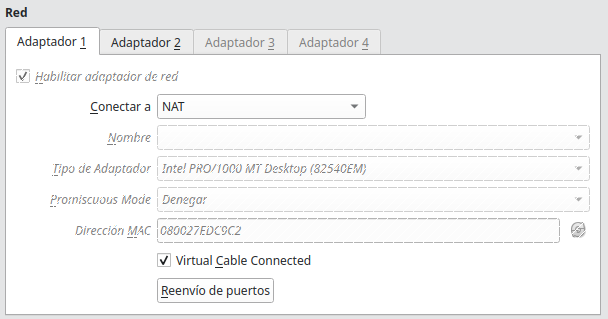

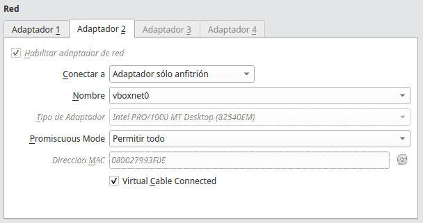

| Interfaz | IP | Gateway | Adaptador de VirtualBox | MAC | Función |
|---|---|---|---|---|---|
| `nic0` | — | — | Adaptador 1 (NAT) | `08:00:27:ED:C9:C2` | Puerto de `vmbr0` |
| `nic1` | — | — | Adaptador 2 (solo anfitrión `vboxnet0`) | `08:00:27:99:3F:0E` | Puerto de `vmbr1` |
| `vmbr0` | `10.0.2.15/24` | `10.0.2.2` | NAT | — | Salida a Internet |
| `vmbr1` | `192.168.56.10/24` | — | Solo anfitrión | — | Gestión y red del laboratorio |

Coincide con el diseño de la fase 2. Solo hay una ruta por defecto, por `vmbr0` hacia `10.0.2.2`. La dirección de gestión es `192.168.56.10`, desde donde abro el panel en `https://192.168.56.10:8006` con el navegador del PC.

En el adaptador 2 cambié el modo promiscuo a "Permitir todo", que hace falta para que las máquinas de dentro de Proxmox se comuniquen por esa red.

#### Resolución de nombres

    cat /etc/resolv.conf
    getent hosts deb.debian.org

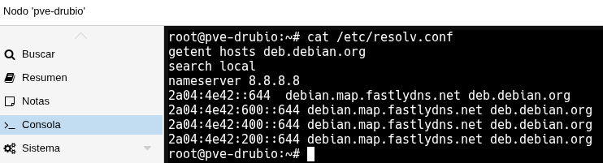

El DNS es `8.8.8.8` y el nodo resuelve `deb.debian.org`.

#### Repositorio de paquetes

Al hacer `apt update` los repositorios enterprise de Proxmox daban error porque son de pago:

    Err:11 https://enterprise.proxmox.com/debian/ceph-squid trixie InRelease
      401  Unauthorized
    Err:12 https://enterprise.proxmox.com/debian/pve trixie InRelease
      401  Unauthorized

En pve-drubio → Actualizaciones → Repositorios desactivé los dos enterprise (`pve` y `ceph-squid`) y añadí el `pve-no-subscription`:

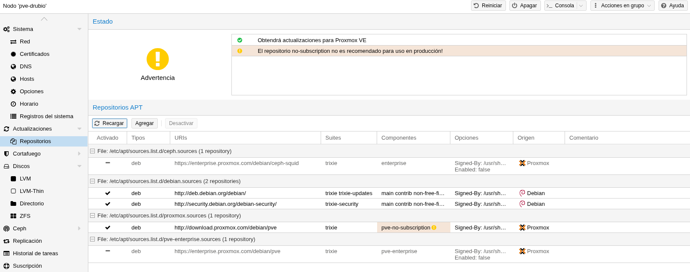

Después `apt update` ya descarga de Debian y de `download.proxmox.com` sin errores:

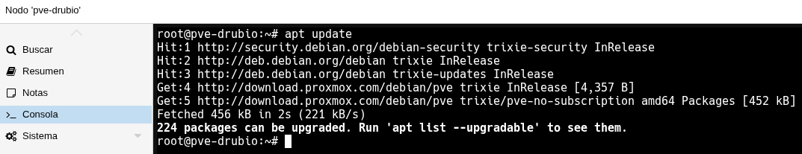

El aviso amarillo del panel solo dice que el repositorio no-subscription no es para producción.

### Conclusión de la fase 4

El panel es accesible desde el PC, la red es la del diseño, el nodo resuelve nombres y descarga del repositorio, y tengo los almacenamientos listos, incluido `copias-pi` para las copias. Lo que queda vigilar es el espacio del disco del PC.

[Volver al indice](../README.md)
