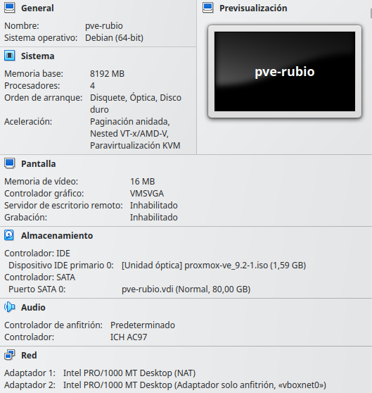
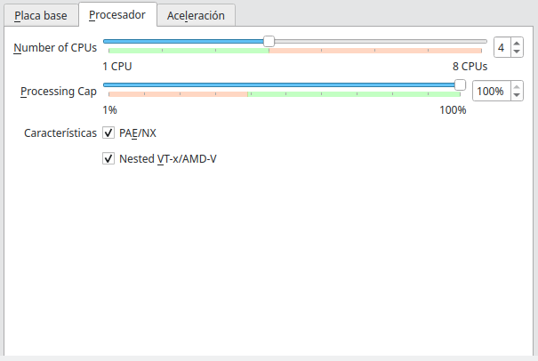
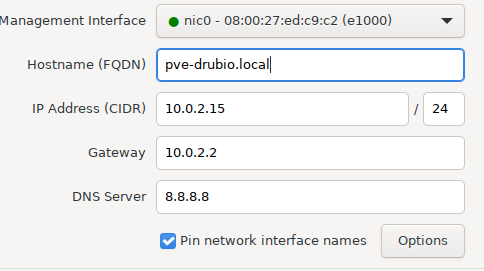
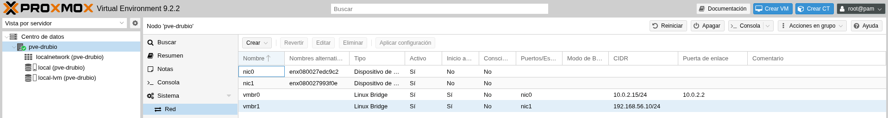
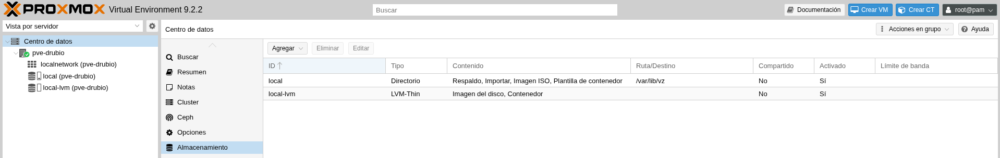
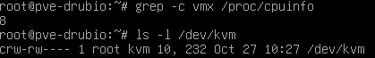

# 03-instalacion-proxmox

## Objetivo

Instalar Proxmox dentro de una máquina virtual de VirtualBox en el equipo de clase y dejarlo con la red que diseñé en la fase 2, para poder entrar al panel web desde el navegador.

## Procedimiento

Lo hice en clase el 27/10/2026.

1. Abrí VirtualBox y apunté la versión: 7.2.4.
2. Usé la ISO de Proxmox VE 9.2.
3. Creé la máquina `pve-rubio`: Debian de 64 bits, 8192 MB de RAM, 4 procesadores y un disco VDI de 80 GB. El PC tiene 8 hilos y 16 GB de RAM, así que me sobran recursos para LliureX y VirtualBox.
4. Le puse dos adaptadores de red: el 1 en NAT, para salir a Internet, y el 2 en solo anfitrión (`vboxnet0`), para entrar al panel desde mi PC.
5. Con la máquina apagada hice los ajustes que pidió el profesor. En Procesador marqué PAE/NX y Nested VT-x/AMD-V, en Aceleración dejé KVM y marqué Nested Paging, y en Almacenamiento puse el controlador SATA de tipo virtio-scsi.
6. Monté la ISO y seguí el instalador: disco `/dev/sda` de 80 GB con ext4, país Spain, zona horaria Europe/Madrid y teclado `es`. En la red usé `nic0`, con el hostname `pve-drubio.local`, la IP `10.0.2.15/24`, el gateway `10.0.2.2` y el DNS `8.8.8.8`.
7. Al terminar quité la ISO y reinicié. La contraseña de root la guardé fuera del repositorio.
8. El instalador solo configura una tarjeta, así que `vmbr1` la añadí a mano en `/etc/network/interfaces`, con `nic1` y la IP `192.168.56.10/24`.
9. Entré desde mi PC a `https://192.168.56.10:8006` con el usuario `root`.
10. Comprobé que KVM está disponible dentro de Proxmox.

## Comandos usados

    # Añadir vmbr1 al final de /etc/network/interfaces
    nano /etc/network/interfaces

    # Lo que escribí
    iface nic1 inet manual

    auto vmbr1
    iface vmbr1 inet static
            address 192.168.56.10/24
            bridge-ports nic1
            bridge-stp off
            bridge-fd 0

    # Aplicar el cambio de red
    systemctl restart networking

    # Comprobaciones de la fase
    hostnamectl
    ip -br addr
    pveversion
    df -h

    # Comprobar KVM
    grep -c vmx /proc/cpuinfo
    ls -l /dev/kvm

## Evidencias

### VirtualBox

Resumen de la máquina `pve-rubio` con sus recursos y los dos adaptadores de red.

Procesador: 4 CPUs con PAE/NX y Nested VT-x/AMD-V marcados.

Aceleración: interfaz KVM y Nested Paging marcado.

El disco `pve-rubio.vdi` en el controlador SATA de tipo virtio-scsi. La unidad IDE está vacía porque ya quité la ISO.

### Instalador

Pantalla de red del instalador con la interfaz, el hostname, la IP, el gateway y el DNS.

Opciones del disco: ext4 y 80 GB.

Resumen antes de instalar.

Contraseña de root (tapada) y un correo inventado.

### Red del nodo

`/etc/network/interfaces` con `vmbr0` (`10.0.2.15/24`, gateway `10.0.2.2`) y `vmbr1` (`192.168.56.10/24`).

Nodo → Sistema → Red: `nic0`, `nic1`, `vmbr0` y `vmbr1`, igual que en mi diseño de la fase 2.

### Panel y almacenamiento

Panel de Proxmox VE 9.2.2 abierto desde mi PC, con el nodo `pve-drubio` en línea.

Almacenamientos: `local` (directorio, para ISO, copias y plantillas) y `local-lvm` (LVM-Thin, para discos de máquinas).

Detalle de `local-lvm`: activo, LVM-Thin y 32,14 GB libres.

Nodo → Discos: un solo disco, `/dev/sda`, con las particiones BIOS boot, EFI y LVM.

### Comprobaciones

Salida de `hostnamectl`, `ip -br addr`, `pveversion` y `df -h`. He tapado Machine ID, Boot ID, Product UUID y Hardware Serial. El nodo es `pve-drubio`, con Debian 13 y Proxmox VE 9.2.2, y los dos bridges están UP con sus IPs.

`grep -c vmx` da 8 (4 vCPU con 2 líneas cada una) y existe `/dev/kvm`, así que la virtualización anidada funciona.

## Incidencias

- **vmbr1 mal escrita.** Puse la IP como `192.168.65.10` sin el `/24` y escribí `bride` en vez de `bridge`, y `vmbr1` no cogía IP. Lo corregí y reinicié la red con `systemctl restart networking`.
- **Nombre del nodo.** La máquina de VirtualBox se llama `pve-rubio`, pero el nodo se quedó como `pve-drubio`. Tengo que igualarlo en el diseño de red de la fase 2.
- **Pendiente.** Arrancar una máquina KVM de verdad dentro de Proxmox. Si no fuera posible, usaría LXC, validándolo antes con el profesor.

## Conclusion

Proxmox VE 9.2.2 está instalado en VirtualBox y entro al panel desde mi PC en `https://192.168.56.10:8006`. La red es la del diseño, con `vmbr0` para salir a Internet y `vmbr1` para el laboratorio, y la virtualización anidada llega a la máquina.

[Volver al indice](../README.md)
